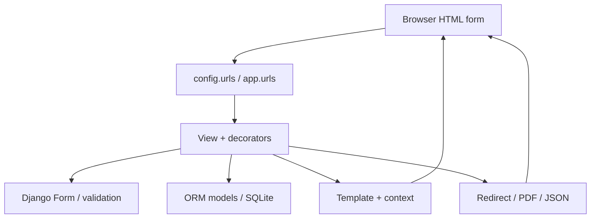
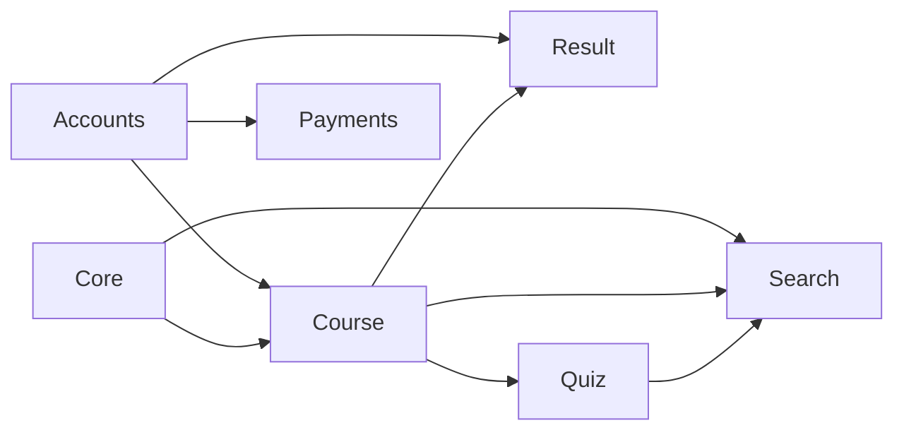

# Kiến trúc hệ thống

> Baseline: [SkyCascade/SkyLearn](https://github.com/SkyCascade/SkyLearn), nhánh `main`, commit `d57f57bd505447b59fdf82b16469494443cafe0c`. Đây là bản kiểm kê mã nguồn, không phải đặc tả tính năng mới. Trạng thái tải source và kiểm thử: [11-SETUP-AND-DEPLOYMENT.md](11-SETUP-AND-DEPLOYMENT.md).

## Cấu trúc

```text
SkyLearn/
  config/          settings, URL root, ASGI/WSGI
  accounts/        custom User, forms, decorators, profiles
  core/            news/events, session, semester, dashboard
  course/          programs, courses, allocations, uploads, registration
  result/          score/grade and PDF
  quiz/            question, sitting, progress, grading
  payments/        invoice and payment prototypes
  search/          aggregate search
  templates/       server-rendered HTML, navigation and forms
  static/          original CSS/JS/fonts/images (not transferred locally)
  media/           tracked media entries; upload destination
  locale/          translations
  requirements/    pinned dependency sets
  scripts/         sample data tooling
```

## Request và response



`config/urls.py` mount 7 app; `accounts/urls.py` include auth views mặc định. Middleware xử lý session, CSRF, auth, message, i18n, static; source: [`config/settings.py`](../config/settings.py), [`config/urls.py`](../config/urls.py). Views là nơi orchestration và logic, `models.py` chứa một số tính toán và signals; không có tầng service riêng trong 7 app.

## Phụ thuộc nghiệp vụ



`Student.program → Program`, `TakenCourse → Student/Course`, `Quiz → Course`, `Sitting → User/Quiz/Course`; xem [schema](04-DATABASE-SCHEMA.md). Templates gọi URL bằng ``, render form/context và submit POST; không đổi tên route, key POST, context, CSRF khi thay giao diện. Không sao chép trực quan các template hiện có.

## Baseline kỹ thuật

WSGI `config/wsgi.py`; ASGI `config/asgi.py`; SQLite mặc định, media cục bộ, static qua WhiteNoise. Không có endpoint REST tổng quát; `ajax/validate-username` và các endpoint thanh toán JSON là ngoại lệ. Xem [contracts](06-BACKEND-CONTRACTS.md).

