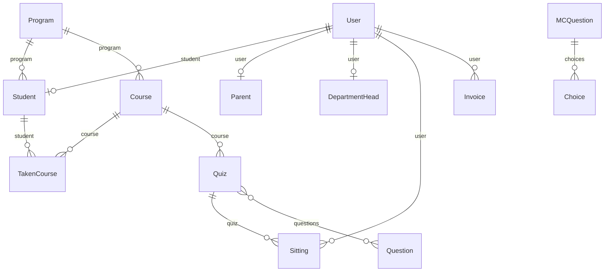

# Database schema

> Baseline: [SkyCascade/SkyLearn](https://github.com/SkyCascade/SkyLearn), nhánh `main`, commit `d57f57bd505447b59fdf82b16469494443cafe0c`. Đây là bản kiểm kê mã nguồn, không phải đặc tả tính năng mới. Trạng thái tải source và kiểm thử: [11-SETUP-AND-DEPLOYMENT.md](11-SETUP-AND-DEPLOYMENT.md).

SQLite mặc định; `DEFAULT_AUTO_FIELD = BigAutoField`; Django auth/session/admin và bảng M2M tự tạo ngoài 24 model nghiệp vụ dưới đây. Danh sách trường khai báo trực tiếp; `User` còn kế thừa các trường `AbstractUser` (username, password, email, flags, groups, permissions, timestamps). Cột dịch do modeltranslation tạo theo migration: đọc [`accounts/migrations/0001_initial.py`](../accounts/migrations/0001_initial.py) và các migration của từng app trước khi sửa DB.

| Model/bảng logic | PK | Trường khai báo trực tiếp (kiểu Django) | Nguồn |
| --- | --- | --- | --- |
| accounts.User | id: BigAutoField mặc định (kế thừa AbstractUser) | is_student: BooleanField; is_lecturer: BooleanField; is_parent: BooleanField; is_dep_head: BooleanField; gender: CharField; phone: CharField; address: CharField; picture: ImageField; email: EmailField | [`accounts/models.py`](../accounts/models.py):70 |
| accounts.Student | id: BigAutoField mặc định | student: OneToOneField; level: CharField; program: ForeignKey | [`accounts/models.py`](../accounts/models.py):151 |
| accounts.Parent | id: BigAutoField mặc định | user: OneToOneField; student: OneToOneField; first_name: CharField; last_name: CharField; phone: CharField; email: EmailField; relation_ship: TextField | [`accounts/models.py`](../accounts/models.py):180 |
| accounts.DepartmentHead | id: BigAutoField mặc định | user: OneToOneField; department: ForeignKey | [`accounts/models.py`](../accounts/models.py):204 |
| core.NewsAndEvents | id: BigAutoField mặc định | title: CharField; summary: TextField; posted_as: CharField; updated_date: DateTimeField; upload_time: DateTimeField | [`core/models.py`](../core/models.py):54 |
| core.Session | id: BigAutoField mặc định | session: CharField; is_current_session: BooleanField; next_session_begins: DateField | [`core/models.py`](../core/models.py):67 |
| core.Semester | id: BigAutoField mặc định | semester: CharField; is_current_semester: BooleanField; session: ForeignKey; next_semester_begins: DateField | [`core/models.py`](../core/models.py):76 |
| core.ActivityLog | id: BigAutoField mặc định | message: TextField; created_at: DateTimeField | [`core/models.py`](../core/models.py):88 |
| course.Program | id: BigAutoField mặc định | title: CharField; summary: TextField | [`course/models.py`](../course/models.py):23 |
| course.Course | id: BigAutoField mặc định | slug: SlugField; title: CharField; code: CharField; credit: IntegerField; summary: TextField; program: ForeignKey; level: CharField; year: IntegerField; semester: CharField; is_elective: BooleanField | [`course/models.py`](../course/models.py):61 |
| course.CourseAllocation | id: BigAutoField mặc định | lecturer: ForeignKey; courses: ManyToManyField; session: ForeignKey | [`course/models.py`](../course/models.py):105 |
| course.Upload | id: BigAutoField mặc định | title: CharField; course: ForeignKey; file: FileField; updated_date: DateTimeField; upload_time: DateTimeField | [`course/models.py`](../course/models.py):123 |
| course.UploadVideo | id: BigAutoField mặc định | title: CharField; slug: SlugField; course: ForeignKey; video: FileField; summary: TextField; timestamp: DateTimeField | [`course/models.py`](../course/models.py):195 |
| course.CourseOffer | id: BigAutoField mặc định | dep_head: ForeignKey | [`course/models.py`](../course/models.py):250 |
| result.TakenCourse | id: BigAutoField mặc định | student: ForeignKey; course: ForeignKey; assignment: DecimalField; mid_exam: DecimalField; quiz: DecimalField; attendance: DecimalField; final_exam: DecimalField; total: DecimalField; grade: CharField; point: DecimalField; comment: CharField | [`result/models.py`](../result/models.py):77 |
| result.Result | id: BigAutoField mặc định | student: ForeignKey; gpa: FloatField; cgpa: FloatField; semester: CharField; session: CharField; level: CharField | [`result/models.py`](../result/models.py):180 |
| quiz.Quiz | id: BigAutoField mặc định | course: ForeignKey; title: CharField; slug: SlugField; description: TextField; category: CharField; random_order: BooleanField; answers_at_end: BooleanField; exam_paper: BooleanField; single_attempt: BooleanField; pass_mark: SmallIntegerField; draft: BooleanField; timestamp: DateTimeField | [`quiz/models.py`](../quiz/models.py):49 |
| quiz.Progress | id: BigAutoField mặc định | user: OneToOneField; score: CharField | [`quiz/models.py`](../quiz/models.py):139 |
| quiz.Sitting | id: BigAutoField mặc định | user: ForeignKey; quiz: ForeignKey; course: ForeignKey; question_order: CharField; question_list: CharField; incorrect_questions: CharField; current_score: IntegerField; complete: BooleanField; user_answers: TextField; start: DateTimeField; end: DateTimeField | [`quiz/models.py`](../quiz/models.py):235 |
| quiz.Question | id: BigAutoField mặc định | quiz: ManyToManyField; figure: ImageField; content: CharField; explanation: TextField | [`quiz/models.py`](../quiz/models.py):372 |
| quiz.MCQuestion | id: BigAutoField mặc định | choice_order: CharField | [`quiz/models.py`](../quiz/models.py):402 |
| quiz.Choice | id: BigAutoField mặc định | question: ForeignKey; choice_text: CharField; correct: BooleanField | [`quiz/models.py`](../quiz/models.py):445 |
| quiz.EssayQuestion | id: BigAutoField mặc định |  | [`quiz/models.py`](../quiz/models.py):468 |
| payments.Invoice | id: BigAutoField mặc định | user: ForeignKey; total: FloatField; amount: FloatField; payment_complete: BooleanField; invoice_code: CharField | [`payments/models.py`](../payments/models.py):5 |

## Relationships

Chi tiết FK/on_delete: [`accounts/models.py`](../accounts/models.py), [`course/models.py`](../course/models.py), [`result/models.py`](../result/models.py), [`quiz/models.py`](../quiz/models.py), [`payments/models.py`](../payments/models.py). `CourseAllocation.courses` là M2M; `Question.quiz` là M2M; `MCQuestion` và `EssayQuestion` kế thừa multi-table từ `Question`. `Parent.student` OneToOne nullable; `Student.program` FK nullable nhưng CASCADE; `Semester.session` FK nullable. Các chuỗi semester/session của `Result` không phải FK.

## Constraints và toàn vẹn

`Program.title`, `Course.code`, `Course.slug`, `Quiz.slug`, `Session.session` unique; `User.username` unique theo AbstractUser. `Course.credit` không có validator dương tường minh; `TakenCourse` không có `UniqueConstraint(student, course)`; add/drop POST có thể tạo bản ghi lặp. `Quiz.pass_mark` kiểm tra 0–100 trong `save()`; `Upload.file` và `UploadVideo.video` kiểm tra phần mở rộng; `Choice.correct` được formset yêu cầu đúng một đáp án trong một lượt tạo, không phải DB constraint. Xem [`course/models.py`](../course/models.py), [`quiz/forms.py`](../quiz/forms.py), [`quiz/models.py`](../quiz/models.py).

