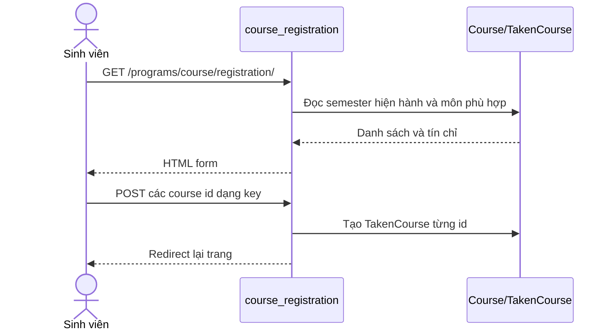
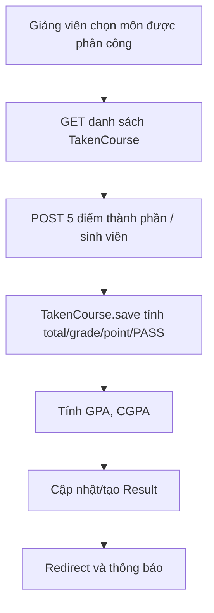
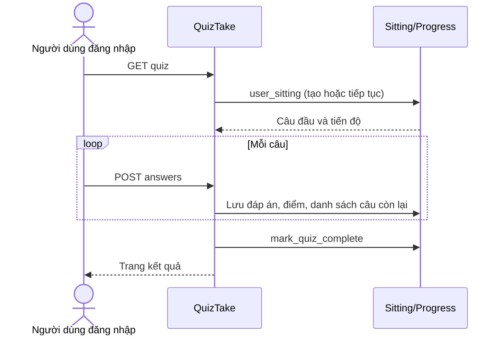

# Luồng nghiệp vụ

> Baseline SkyLearn `main@d57f57bd505447b59fdf82b16469494443cafe0c`. Các ID nối với [03](03-BUSINESS-REQUIREMENTS.md), [06](06-BACKEND-CONTRACTS.md) và [09](09-TRACEABILITY-MATRIX.md).

## Đăng ký/hủy học phần

GET lọc `program`, `level`, semester hiện hành và loại ID đã học. POST không lặp điều kiện lọc; có khả năng đăng ký lặp/khác chương trình nếu input bị sửa. Hủy POST `course_ids` xóa TakenCourse rồi redirect. Source `course/views.py::course_registration/course_drop`; `result/models.py::TakenCourse`.

## Nhập điểm

Cần session + semester hiện hành; mỗi sinh viên có 5 giá trị theo thứ tự cố định. `Result` lưu semester/session dạng CharField; luồng create dùng catch-all exception. Source `result/views.py::add_score_for`, `result/models.py::TakenCourse.save`.

## Quiz

`single_attempt` chặn nếu đã có Sitting hoàn tất; `exam_paper=false` hoặc lecturer/admin làm bài thì Sitting hoàn tất bị xóa sau render. `Progress.list_all_cat_scores` trả rỗng. Source `quiz/models.py::SittingManager.user_sitting`, `quiz/views.py::QuizTake`.

## Trạng thái

| Đối tượng | Trạng thái | Chuyển trạng thái/điều kiện |
| --- | --- | --- |
| Sitting | new/incomplete → complete | Tạo khi bắt đầu; POST từng câu; complete khi hết câu; có thể xóa sau kết quả |
| Invoice | payment_complete false → true | stripe_charge/paymentComplete; prototype chưa xác minh chạy |
| Session/Semester | is_current false/true | View add/update thay current, xem core/views.py |
| TakenCourse | chưa đăng ký → đăng ký → xóa | course_registration POST; course_drop POST |
| Quiz | draft true/false | Quiz model; draft ẩn khỏi quiz list với user không có quyền edit |

## Thất bại

Form invalid hiển thị errors tùy view; thiếu kỳ hiện hành báo lỗi ở GET registration/score; quiz rỗng redirect danh sách; quiz một lượt đã hoàn thành redirect; không có transaction bao trùm POST đăng ký nhiều môn hay nhập nhiều sinh viên. Trạng thái thực tế phải kiểm thử sau khi có môi trường Python và đầy đủ assets.

